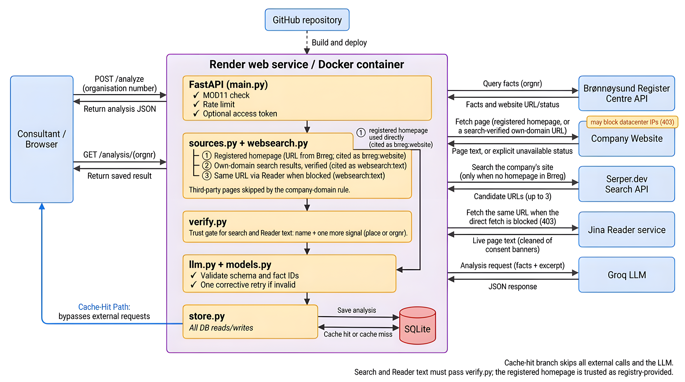

# AI Opportunity Analyser | BDO Case | README

**BDO CASE | AI Engineer | Dr. Ravindra R. Patil**

Live application: https://bdo-ai-case.onrender.com (health check: /health)
Repository: https://github.com/RavindraPatilg/bdo-ai-case

## Repository layout

```
bdo-ai-case/
├── app/            FastAPI application (config, sources, verify, websearch, llm, models, store, main)
├── tests/          5 offline tests plus the offline guarantee in conftest.py
├── docs/           Deliverable README (Word/PDF), saved analyses, design notes, architecture sketch
├── infra/          How the cloud environment is set up
├── Dockerfile      Container image; binds to the platform-provided PORT
├── render.yaml     Infrastructure as code for the Render service
└── requirements.txt, pytest.ini, .env.example, .gitignore
```

A complement with design-decision justifications (choice, reasoning, rejected alternative), the project journey, and the agentic next step is in `docs/design\_notes.docx`.

## 1\. Deployment and testing

**Architecture:** FastAPI app in a Docker container, deployed on Render.com (free tier, Frankfurt region), built automatically from the Git repository. Public HTTPS URL from Render's ingress. Secrets are passed as Render environment variables, never committed to the repository. SQLite stores saved analyses. Deployment commands and infrastructure-as-code (`render.yaml`) are in `infra/README_deployment.md`.

**Model:** `openai/gpt-oss-20b` served by Groq, a free OpenAI-compatible API. The application talks to any OpenAI-compatible provider through configuration (`OPENAI_BASE_URL`, `OPENAI_MODEL`, `OPENAI_API_KEY`); the provider was switched once during the project (GitHub Models was retired by Microsoft mid-project) without any code change, which demonstrates the value of this abstraction.

**Local run:** copy `.env.example` to `.env`. Set `LLM_PROVIDER=mock` for a no-key demo, or configure a real provider key as an environment secret. Run `pip install -r requirements.txt`, then `python -m pytest tests/ -q`, then `uvicorn app.main:app --port 8000`. Open `http://localhost:8000`. The Dockerfile binds to the platform-provided `PORT` with a fallback to 8000, so the same image runs locally and in the cloud.

**Tests:** 5 offline pytest tests, one per requirement that matters: (1) input check - typo orgnr rejected before any external call or LLM cost; (2) registry - facts parsed correctly, Brreg failure is a clean status; (3) trust - the LLM answer is validated, invented fact IDs are rejected; (4) pipeline - full flow offline with mocked externals; (5) cache - a repeat never triggers a new LLM call. They make no external calls.

## 2\. Architecture and components

Browser / API -> FastAPI -> Brreg facts + unstructured source (registered homepage, or a search-verified company site fetched via the Reader service when blocked) -> LLM grounded in fact IDs -> schema and source validation -> SQLite cache. GET `/analysis/{orgnr}` returns the saved result without another LLM call (see Figure 1 in `docs/architecture.png`).



*Figure 1: Architecture of the AI Opportunity Analyser.*

|Component|Role|Key choice|
|-|-|-|
|sources.py|Brreg facts, page fetching (browser identities, byte cap), consent-banner cleaning, source-selection ladder|Failures become visible statuses, never an unhandled crash|
|verify.py|Verification of every fetched page against the registry facts (name + one more signal)|A page that does not match the facts is never used|
|websearch.py|Serper search, only when Brreg has no registered homepage|Candidates restricted to the company's own domain by a general rule, no blocklist|
|llm.py|Grounded prompt, strict JSON, one corrective retry|Rejects malformed output and unknown fact IDs; provider-agnostic|
|models.py|Pydantic data contract for facts, sources, assessments|Assessment cannot be confused with sourced facts|
|store.py|SQLite persistence by orgnr|No new LLM call for a repeated request|
|main.py|API, simple form, logging, rate limit, optional token|Input check + per-IP cost protection|

## 3\. Technical choices and scope

|Choice|Reason / deliberately not built|
|-|-|
|FastAPI + Pydantic|Provides API and simple UI; strict output validation. Streamlit avoided because API is required.|
|Render.com hosting|Git-connected Docker deploy, free tier, EU region. Azure was attempted first: the employer Azure tenant did not permit resource creation, and a new personal subscription restricts Docker image builds (ACR Tasks) - full chain in `infra/README\_deployment.md`.|
|Groq-hosted GPT-OSS-20B|Free tier, OpenAI-compatible; the provider sits behind one configuration layer, so it can be swapped without code changes.|
|SQLite|Simple persistent cache for case scope. No managed database needed for demo.|
|Single webpage fetch|Full crawler, rankings, email drafts and contact suggestions are explicitly out of scope.|
|One LLM call with schema + retry|One LLM call per analysis; strict JSON validated in code against the schema and the collected fact IDs, one retry with a targeted correction on invalid output. Trust comes from this check: only grounded suggestions reach the screen. The architecture follows the data: at this scope (one registry record plus one unstructured source) agent frameworks and vector databases would add overhead without value; with a per-company document corpus in the next version they become the right fit.|
|MOD11 check + rate limit + cache|Cheapest checks first: typo orgnr rejected before any call, repeats cost nothing.|
|Access: public demo, unprotected by design|Public registry data only, per-client rate limit and bounded cost; an optional shared-token mechanism exists (`APP_ACCESS_TOKEN`). Production would use Entra ID and role-based access.|
|Missing website in Brreg|Recorded as an explicit unavailable status. An opt-in Serper search (off by default) finds candidates restricted to the company's own domain by a general name-token rule (no blocklist); every URL is verified against the registry facts before use. If the live page blocks access, the same URL is fetched through the Reader service and must still pass verification.|
|Citation scheme|Registered homepage content is cited as `brreg:website`; a search-verified page is cited as `websearch:text`. Page text is never cited as `brreg`, so every citation shows its true origin.|
|Qualitative expected values|The prompt forbids invented percentages, figures, dates or targets in titles, descriptions and expected values; unsourced specifics in an audit context destroy trust.|
|Clean consultant view|The page shows only sources the analysis used (ok status); rejected attempts remain in the saved data and the logs for full auditability.|

## 4\. Trust separation: documented facts vs AI assessment

The boundary is enforced in code and visible in the UI. Facts are fetched only from Brreg or the company's own verified website and carry a `fact_id`, source, source URL and retrieval time. The LLM receives those facts and must cite fact IDs for each use case; a suggestion grounded only in website content is rejected. Assessments are explicitly marked `is_assessment=true` and stored separately. The validator rejects unknown or missing fact IDs before results are displayed. Limitations are stored as a third section. The page displays separate zones: Documented facts, AI assessment, Limitations. Logs record orgnr, source statuses and model per analysis.

## 5\. Limitations and production needs

* Current cache is single-container SQLite; production should use managed PostgreSQL or Azure Table Storage with durable backup.
* Render's free instance sleeps after 15 minutes idle; the first request then takes about a minute. A paid instance removes this.
* Rate limiting is in-process; production should use shared gateway/redis-backed limits for multiple instances.
* Optional shared token is demo protection, not full authentication. Production should use Entra ID and role-based access.
* Website extraction handles static HTML only; JavaScript-heavy sites need rendering, with robots.txt and rate limits respected.
* LLM output quality needs evaluation over a broader dataset, prompt versioning, monitoring, and human review before a consultant acts on advice.
* Structured logs are provided; production needs Application Insights or similar, alerts, retention and cost monitoring.
* Board-member names and other personal data are not stored or sent to the LLM. A formal privacy impact assessment and retention policy would be needed for production.

## 6\. What did not work at first

* The originally planned free LLM provider, GitHub Models (gpt-4o-mini), was fully retired by Microsoft on 30 July 2026, mid-project. Because the provider sits behind configuration, the switch to Groq required no code change.
* The Azure Container Apps deployment was fully prepared but blocked by Azure's restriction on ACR Tasks for new subscriptions; the deployment moved to Render, keeping the free-tier requirement.
* Early model runs occasionally returned valid JSON with zero use cases, or answers wrapped in markdown fences; each was rejected by validation, retried once with a corrective instruction, and the prompt was hardened.
* Solstad's site blocks datacenter IPs with 403 even for browser identities; the Reader service rung was added.

## 7\. Saved-output transparency

`docs/saved\_outputs.json` contains five live analyses against the deployed application, one for each test company in the case: DOF Group ASA (930053112), Solstad Offshore ASA (945883294), Simon Møkster Shipping AS (987341947), Archer AS (934361156) and Eviny AS (880309102). All are genuine model output (`openai/gpt-oss-20b` via Groq) with real Brreg facts. Archer's and Eviny's registered homepages were retrieved live; DOF and Simon Møkster have no homepage registered, so the search fallback found and verified their own pages (dof.com/contact, mokster.no/career); Solstad's site blocks datacenter IPs, so its live page was fetched through the Reader service and verified. Repeat requests for the same orgnr are served from the SQLite cache without a new LLM call.

**Known gaps:** no evaluation harness for the suggestions yet, no multi-page crawler, and no production-grade identity or monitoring. With more time, I would add a prompt-evaluation set spanning all five test companies and a broader sample of Norwegian businesses, durable cloud storage, and operational telemetry.

